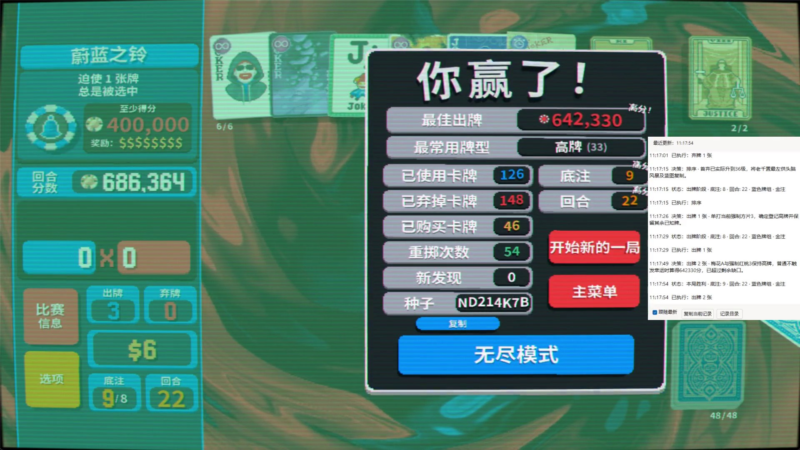

# Balatro Agent

English | [简体中文](README.zh-CN.md)

**Let AI take the next run of Balatro.**

A tool-capable AI uses local MCP tools to read player-visible information, choose and execute game actions, and save and reuse what it learns.

For **Windows x64 · Steam Balatro · Codex desktop**. The launcher and play activity window support English and Chinese.

## Gold Stake clear

**GPT-6.1 Sol has cleared Blue Deck / Gold Stake using Balatro Agent.** Click to watch a 26-second gameplay excerpt (waiting periods sped up).

## Download and play

1. **[Download the v1.4.0 project ZIP](https://github.com/KaishenChiang/Balatro-Agent/releases/download/v1.4.0/balatro-agent-1.4.0-source-candidate.zip)** and extract it to a permanent folder. Keep the whole folder. Install the Steam edition of Balatro and sign in to Codex; close the game normally before installation or updates.
2. Open **[Balatro Agent.exe](<Balatro Agent.exe>)** and wait for **Ready**. It finds the project and game, prepares dependencies, backs up and installs the Mods, and configures MCP. No separate Python installation is needed.
3. Choose **Deck** and **Stake / mode**, then click **Start in Codex**. When Codex supports the project link, it opens a project chat with the prompt filled in. Review and **send the prompt in Codex** to begin. The launcher closes after successfully dispatching the opening request.

If the project link does not open, reopen the launcher and use **Copy play prompt**. Paste it into a local Codex chat with the `balatro-agent` tools loaded. Both paths use the same short prompt with the actual project path, your selections and a play-rules file reference, so you do not need to select the project folder first. If tools are missing after setup, reload MCP or reopen Codex.

The launcher follows the Windows display language by default; use **Language / 语言** to switch. You can close the launcher after sending the prompt. Keep the project folder.

If an earlier action is unconfirmed, its receipt is missing, or a checkpoint is damaged, normally close Balatro and click **Abandon session / prepare** on the launcher's error page. Old records stay preserved and old actions are never replayed. You can start again after preparation; reopening the launcher also resumes an interrupted archive. [Recovery details](docs/balatro-ai/maintenance.en.md)

## Test other models with CC Switch

Use [**CC Switch**](https://github.com/farion1231/cc-switch) to configure other model providers in Codex and continue using this project's local MCP tools and [**Balatro Agent.exe**](https://github.com/KaishenChiang/Balatro-Agent/blob/main/Balatro%20Agent.exe). **DeepSeek V4.1 Flash has been successfully connected through CC Switch and used to play this project.**

## Live play activity

An MCP game launch opens an independent activity window. Its **HH:mm:ss** timeline shows stage changes, short decisions, plan updates, action results, and experience saves. It displays the model's submitted rationale and plans.

Close the window at any time without interrupting play; double-click **[Balatro Status.exe](<Balatro Status.exe>)** to reopen it. The command `Balatro Agent.exe --monitor` also works. [How it works and measured overhead](docs/balatro-ai/activity.md)

Each run's activity is automatically saved under `runs/live/activity/by-run/`. Normal results and post-run experience saves stay with that run.

## Decks and stakes

The default is **Red Deck / White Stake**. Choose from **15 original decks**; the selected deck must be visibly unlocked. After you send the play prompt, the AI first opens or shows the game, then checks the connection.

| Stake / mode | Behavior |
| --- | --- |
| White, Red, Green, Black, Blue, Purple, Orange, Gold | One run at the selected stake |
| Highest stake | One run at the highest unlocked stake for that deck |
| Climb mode | Start at that deck's highest unlocked stake; retry normal losses, advance one stake after a verified win, and continue until beating Gold or you ask to stop |

Climb mode reports and reviews each run before continuing.

## Results and experience

Each completed run returns a brief report: **actual deck / stake · win or loss · ante / round · elapsed time · experience update status**.

After a single run or a completed climb, **the game stays on the results screen with its window open**. A climb continues after each run's report.

The AI reads the [general guide](experience/README.md) before playing and other topics as needed. Both source baselines and local experience keep one `current.md` per topic; local updates amend and atomically replace that same file. Local experience takes priority and stays in `runs/local-experience/`.

## More information

[Setup and recovery](docs/balatro-ai/maintenance.en.md) · [English support](docs/balatro-ai/english-support.md) · [Play rules](prompts/bootstrap.en.md) · [Verification evidence](evidence/README.md) · [Changelog](CHANGELOG.md)

## License

Self-authored code, documentation, and experience use the [MIT License](LICENSE). Third-party licenses are listed in [NOTICE](third_party/NOTICE.md).
